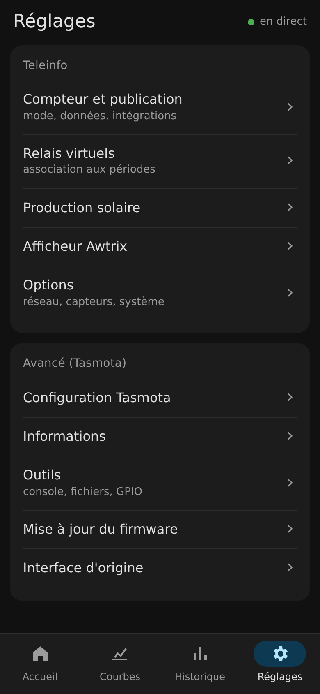

# Interface mobile Teleinfo (prototype)

Nouvelle interface web pensée pour le téléphone, **à côté** de l'interface actuelle : les pages existantes ne sont pas modifiées.

| Accueil | Courbes 24 h | Réglages |
|---|---|---|
|  |  |  |

## Principe

- HTML, CSS et JavaScript sans dépendance ni étape de compilation (`index.html`, `app.css`, `app.js`).
- Ne lit que des routes déjà présentes dans le firmware : `/cm?cmnd=Status 10`, `/tic-msg.upd`, `/info.json`, `/graph` + `/graph.upd`.
- Material Design 3, thème clair ou sombre selon le téléphone.
- Les réglages et les écrans Tasmota restent ceux du firmware, regroupés dans un onglet « Réglages ».

## Essayer sans toucher au module

```
python3 teleinfo/web/proto/serveur.py --module <IP du module>
```

puis ouvrir `http://<IP de la machine>:8099/` sur le téléphone. Le serveur relaie seulement des lectures (seules les commandes `Status` passent par `/cm`).

## Suite

L'avancement est suivi dans les issues du dépôt (étiquette `interface-mobile`).
