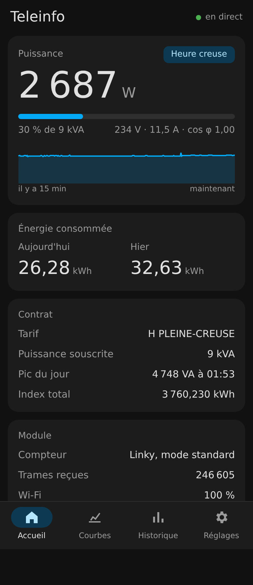
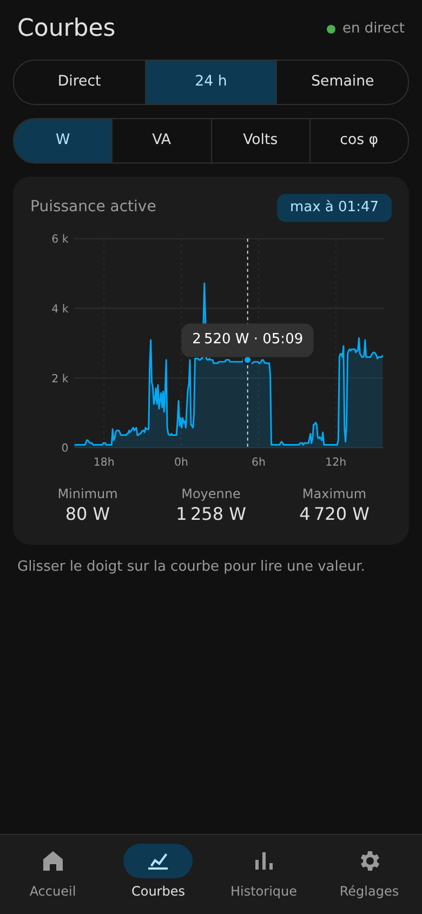
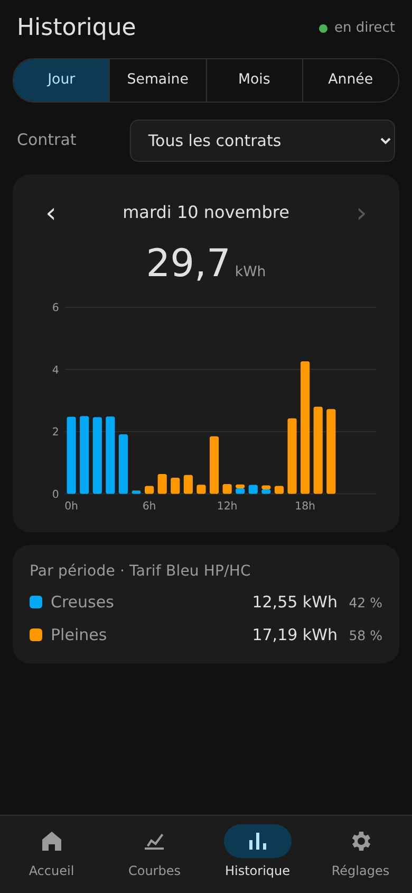
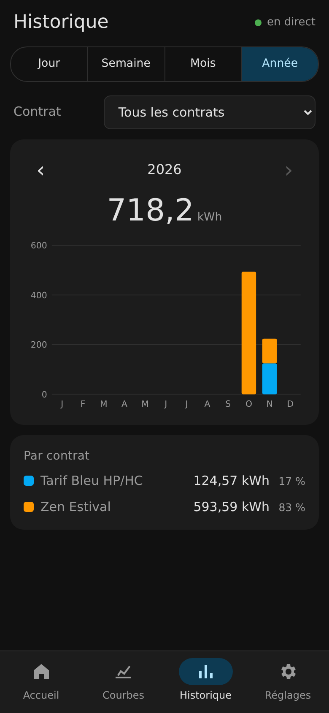
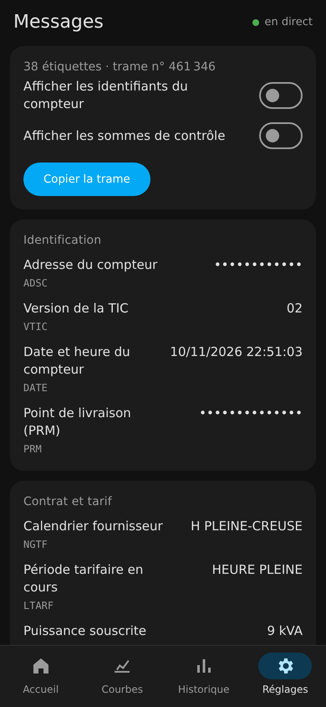
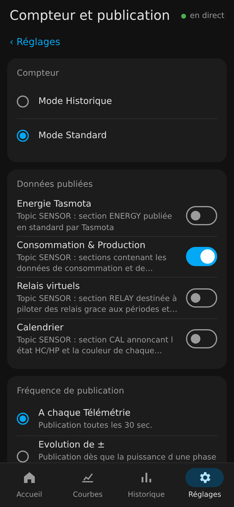

# Interface mobile Teleinfo (prototype)

Nouvelle interface web pensée pour le téléphone, **à côté** de l'interface actuelle : les pages existantes ne sont pas modifiées.

| Accueil | Courbes 24 h | Historique |
|---|---|---|
|  |  |  |

| Historique, tous contrats | Messages TIC | Réglage du compteur |
|---|---|---|
|  |  |  |

## Principe

- HTML, CSS et JavaScript sans dépendance ni étape de compilation (`index.html`, `app.css`, `app.js`).
- Ne lit que des routes déjà présentes dans le firmware : `/cm?cmnd=Status 10`, `/tic-msg.upd`, `/info.json`, `/graph` + `/graph.upd`, les CSV d'historique (`/ufsd?download=`) et les pages de réglage Teleinfo.
- Les réglages Teleinfo (`/tic-cfg`, `/relay`, `/solar-cfg`, `/awtrix`, `/option`) sont relus depuis les pages d'origine et enregistrés avec les mêmes paramètres : aucun code C++ à modifier.
- L'historique peut afficher tous les contrats de l'année ensemble, ce qui garde la consommation visible après un changement de contrat.
- Material Design 3, thème clair ou sombre selon le téléphone.
- Les réglages et les écrans Tasmota restent ceux du firmware, regroupés dans un onglet « Réglages ».

## Essayer sans toucher au module

```
python3 teleinfo/web/proto/serveur.py --module <IP du module>
```

puis ouvrir `http://<IP de la machine>:8099/` sur le téléphone. Le serveur relaie seulement des lectures (seules les commandes `Status` passent par `/cm`, et l'enregistrement des réglages est refusé).

## Installer sur le module, sans recompiler

Le module sert lui-même l'interface grâce à un petit pilote Berry (`berry/mobile.be`) : les fichiers sont copiés dans son système de fichiers et servis sur `/m`. Un bouton « Interface mobile » apparaît sur l'accueil, la page Configuration et les Outils d'origine.

```
teleinfo/web/berry/installer.sh <IP du module>              # jusqu'au prochain redémarrage
teleinfo/web/berry/installer.sh <IP du module> --permanent  # chargé à chaque démarrage (autoexec.be)
```

Pour retirer : supprimer `mobile.be`, les fichiers `mobile-*` et la ligne `load('mobile.be')` de `autoexec.be` depuis le gestionnaire de fichiers.

## Suite

L'avancement est suivi dans les issues du dépôt (étiquette `interface-mobile`).
